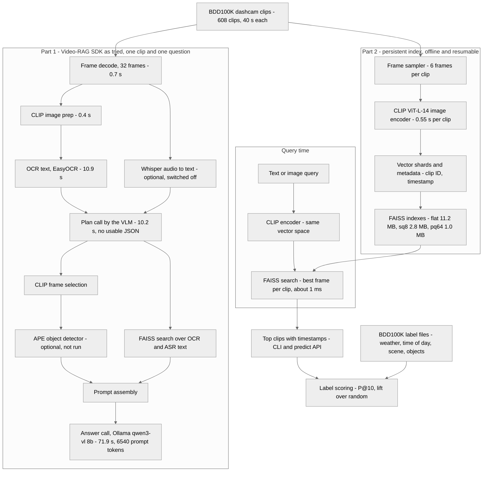

# Dashcam multimodal retrieval: Video-RAG trial + a persistent CLIP/FAISS index

Task: multimodal retrieval with an open-source video RAG SDK.
Problem: fleet and self-driving teams have far more dashcam footage than anyone can review. I want to find clips by condition ("a rainy night road") without watching them.
Data: BDD100K dashcam clips (40 s each) and its per-clip label files. Data is not in this repo.

## 1. What I tried: Video-RAG SDK
Repo: https://github.com/Leon1207/Video-RAG-master (NeurIPS 2025). It answers a question about one video by pulling OCR, speech and object-detection text, retrieving the relevant pieces with FAISS, and giving them to a video-language model.

I ran it locally on a Mac with changes: Ollama (`qwen3-vl:8b`) instead of LLaVA, OpenCV instead of decord.

One clip, one question, measured stages (single run):

| Stage | Time |
|---|---|
| Frame decode | 0.7 s |
| CLIP frame prep | 0.4 s |
| OCR (EasyOCR) | 10.9 s |
| Plan call (VLM) | 10.2 s (6.4 s was one-time model load; returned no usable JSON) |
| Answer call (VLM) | 71.9 s (6,540 prompt tokens, 65.7 s prompt processing) |
| Total of timed stages | about 94 s |

Why I did not build on it for search:
- **Too slow:** about 94 s per clip per question. For 608 clips that is roughly 16 hours (my estimate), against about 6 minutes for the index below.
- **One video at a time:** its FAISS index is built in memory from that video's OCR/speech text and thrown away. There is no persistent index across clips.
- **Little text on dashcam clips:** the retrieval step works on OCR and speech text, which dashcam footage has little of. I did not time or log the FAISS step.
- **Detector needs a server:** object detection (APE) runs as a separate service, which I did not run on a Mac.
- **Hard-wired model:** it imports LLaVA directly. Using another model means editing the pipeline file by hand.

`src/vidrag_pipeline.py` and `src/tools/` are my modified copy of the SDK's pipeline, kept only to show the changes. Upstream states no license, so check before reusing it.

## 2. What I added: a persistent multimodal index
Not part of the SDK. It adds what the SDK has no equivalent for: searching across many clips.


- Same CLIP backbone the SDK uses (`openai/clip-vit-large-patch14`), but not the SDK's code.
- Frames at 2, 6, 10, 14, 22 and 30 s per clip. The 10 s frame is the one BDD100K labels.
- Three indexes: exact (flat), 8-bit scalar quantized (sq8), product quantized (pq64).
- Resumable build: vectors are saved in shards, finished clips are skipped on rerun.
- The built index is committed in `index_out/` so you can search without rebuilding.

## 3. Results (608 clips, 3,648 frame vectors)
Scored against BDD100K's own labels. No hand labeling. "Lift" is precision at 10 divided by the share of relevant clips, so 1.0x is random.

### Queries tried (flat index; sq8 and pq64 gave the same numbers)
| Query | Relevant clips | Base rate | P@10 | R@50 | Lift over random |
|---|---|---|---|---|---|
| a rainy road | 32 | 0.05 | 0.80 | 0.56 | 15.2x |
| a snowy road | 38 | 0.06 | 0.80 | 0.61 | 12.8x |
| night driving | 239 | 0.39 | 1.00 | 0.21 | 2.5x |
| a highway | 174 | 0.29 | 0.90 | 0.19 | 3.1x |
| a residential street | 51 | 0.08 | 0.70 | 0.43 | 8.3x |
| a rainy night road | 14 | 0.02 | 0.50 | 0.57 | 21.7x |

Skipped for having fewer than 5 relevant clips among the 608: a foggy road, a tunnel.
Common classes have a capped lift: "night driving" covers 39% of clips, so 2.5x is the maximum possible, and the score is perfect. R@50 is capped the same way.

### Summary
| | flat | sq8 | pq64 |
|---|---|---|---|
| Index size | 11.2 MB | 2.8 MB | 1.0 MB |
| Mean P@10 (9 queries) | 0.78 | 0.78 | 0.78 |
| Mean lift over random | 8.0x | 8.0x | 8.0x |
| FAISS search per query | about 1 ms | about 1 ms | about 1 ms |

- Embedding took about 0.55 s per clip (337 s for 608 clips), roughly 70x faster than the SDK's question-answering path.
- Compression made no measurable difference on these queries.
- Rare conditions gain most: "a rainy night road" (14 relevant clips) scored over 20x random.
- Per-query results for all indexes: `results/eval.json`.

 End-to-end system architecture



## 4. Limitations
- **Easy queries:** these are attributes a metadata filter could answer, since the labels are the ground truth. The result shows CLIP recovers known attributes from pixels. It does not show events like cut-ins or hard braking.
- **Labels cover one frame:** BDD100K labels describe the frame at 10 s. Use `--only10` for the fairest scores.
- **Small evaluation:** 608 clips, 9 queries. Foggy, tunnel and some object queries were skipped for having too few relevant clips.
- **pq64 overlap:** exact-neighbour overlap with flat was about 0.69, while query results were identical. Different tests, different meaning.
- **Search time vs load time:** the roughly 1 ms is FAISS search only. Loading CLIP and the index takes seconds.
- One measurement for the SDK timings, not an average.

## 5. Proposed extensions for the SDK (future work, not implemented in the SDK)
- Persistent, multi-video index with save and load.
- Pluggable VLM backend (Ollama or others) instead of hard-wired LLaVA.
- Pluggable object detector that runs without a server on Mac or CPU.
- Use the index as a first stage, then the SDK's retrieve-and-answer flow on the top few clips.
- Index OCR and speech for video types that have them (meetings, lectures).
- Event queries (cut-ins, hard braking) using IMU and GPS data.

## Run (from the repo root)

To run the video demo, first download the BDD100K video data (about 16 GB) from [the BDD100K dataset site](https://bdd-data.berkeley.edu/) and extract the clips. The dataset is not included in this repo. Set `BDD_VIDEO_DIR` to the directory containing the `.mov` or `.mp4` files; the demo indexes up to 20 clips by default. Label files are only needed for evaluation, not for the demo or search.

```bash
python -m venv venv && source venv/bin/activate
pip install -r requirements.txt
export BDD_VIDEO_DIR=<folder of .mov/.mp4 clips>
export BDD_LABELS_DIR=<folder of per-clip BDD100K label .json files>
```
```bash
python src/main.py --mode demo  --n 20     # quick demo
python src/main.py --mode build --n 3000                        # embed clips, build indexes
python src/main.py --mode search --query "a rainy night road" --index sq8
python src/main.py --mode eval --only10                         # score against labels
```
API:
```bash
uvicorn --app-dir src api:app --port 8000
curl -X POST localhost:8000/predict -H "Content-Type: application/json" \
     -d '{"query": "a rainy night road", "k": 5, "index": "sq8"}'
```
Run everything from the repo root. The first run downloads the CLIP model (about 1.7 GB). Data: BDD100K from bdd-data.berkeley.edu, see its license.

Apple Silicon note: FAISS and PyTorch each ship an OpenMP library, which can crash on Mac. The scripts set `KMP_DUPLICATE_LIB_OK=TRUE` and `OMP_NUM_THREADS=1` and import faiss before torch.

## Repo layout
- `src/main.py`: entry point (demo, build, search, eval)
- `src/clipindex.py`: frame sampling, CLIP embedding, FAISS indexes
- `src/api.py`: search API
- `src/vidrag_pipeline.py`, `src/tools/`: modified SDK pipeline (trial)
- `index_out/`: built indexes and metadata
- `results/`: evaluation output
